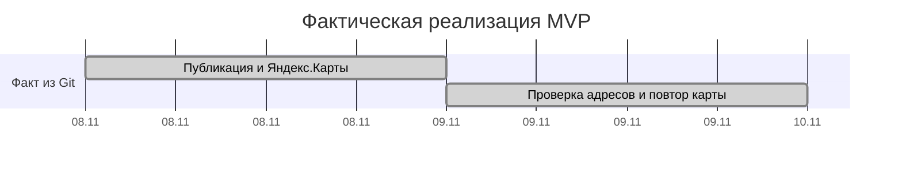
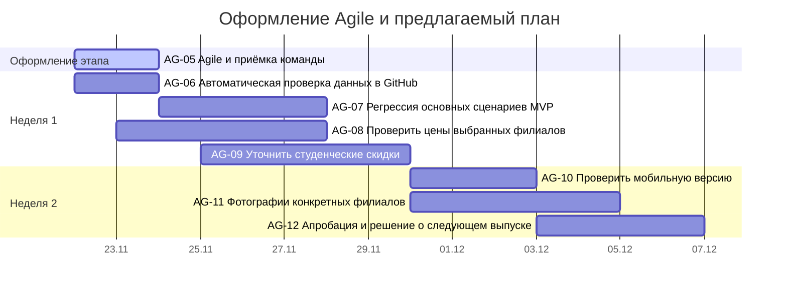

# Диаграмма Ганта

Срез 2026-11-22. 8–9 ноября — подтверждённый период реализации по Git. Название «спринт» задним числом не присваивается. План с 23 ноября предварительный, срок сдачи преподавателем не задан. Диаграмма показывает календарные даты, не трудозатраты.

## Зависимости и контрольные точки

- AG-06 перед AG-07: автоматические проверки дают основу регрессии.
- AG-07 перед AG-10: сначала основные сценарии, затем подробная мобильная проверка.
- AG-07 и AG-10 перед AG-12: апробация после устранения блокирующих ошибок.
- Цены и скидки исследуются параллельно. Отсутствие ответа не блокирует выпуск, если интерфейс явно показывает неизвестные сведения.
- 29 ноября: плановая демонстрация первой недели. 6 декабря: плановое решение о следующем выпуске. Это будущие контрольные точки, а не проведённые встречи.

| Задача | Начало | Завершение | Зависимости |
| --- | --- | --- | --- |
| [AG-05](https://github.com/milanaarus/pitanie-ryadom-mvp/issues/5) | 2026-11-22 | 2026-11-23 | нет |
| [AG-06](https://github.com/milanaarus/pitanie-ryadom-mvp/issues/6) | 2026-11-22 | 2026-11-23 | AG-05 |
| [AG-07](https://github.com/milanaarus/pitanie-ryadom-mvp/issues/7) | 2026-11-24 | 2026-11-27 | AG-06 |
| [AG-08](https://github.com/milanaarus/pitanie-ryadom-mvp/issues/8) | 2026-11-23 | 2026-11-27 | нет |
| [AG-09](https://github.com/milanaarus/pitanie-ryadom-mvp/issues/9) | 2026-11-25 | 2026-11-29 | нет |
| [AG-10](https://github.com/milanaarus/pitanie-ryadom-mvp/issues/10) | 2026-11-30 | 2026-12-02 | AG-07 |
| [AG-11](https://github.com/milanaarus/pitanie-ryadom-mvp/issues/11) | 2026-11-30 | 2026-12-04 | нет |
| [AG-12](https://github.com/milanaarus/pitanie-ryadom-mvp/issues/12) | 2026-12-03 | 2026-12-06 | AG-07, AG-10 |
